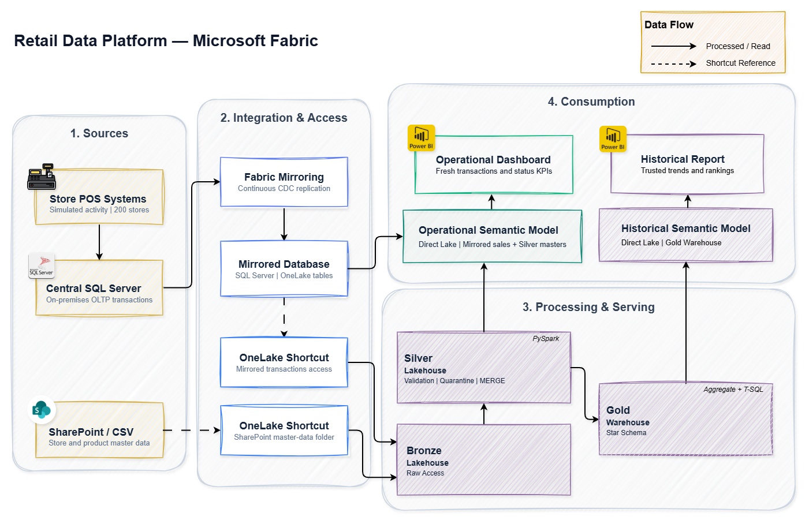
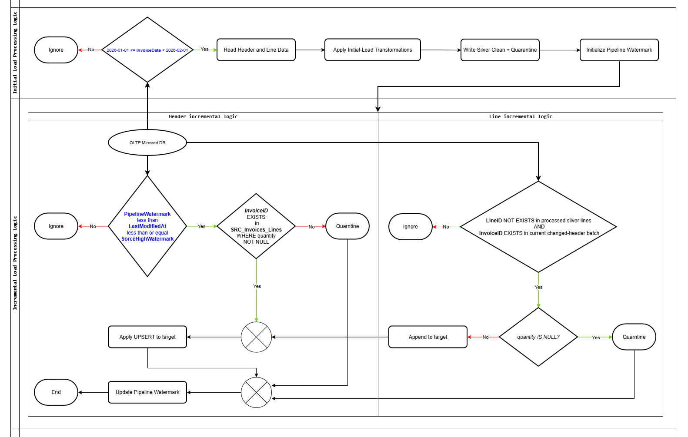
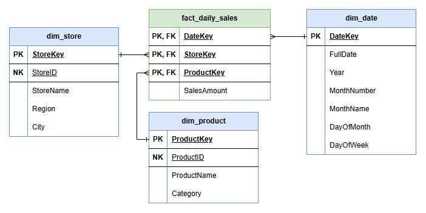
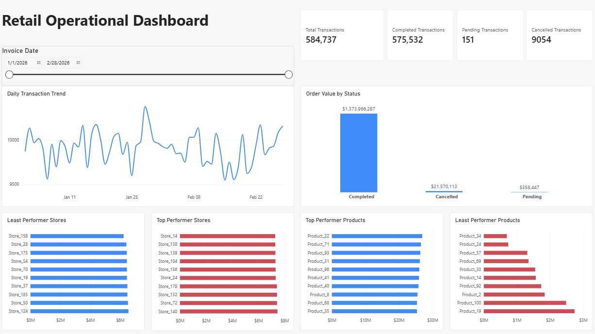
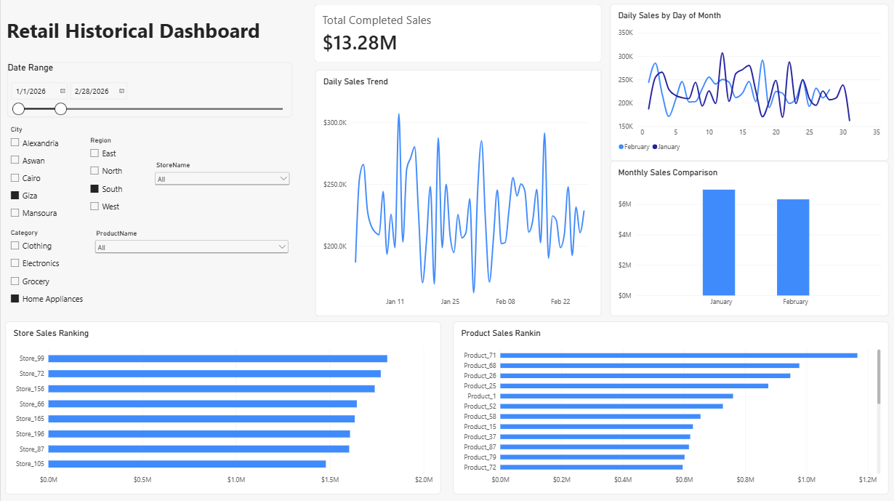

# Retail Data Platform — Microsoft Fabric

I built this project around a retail business with 200 stores. It uses synthetic point-of-sale data to support two needs: monitoring recent transactions and reporting on validated historical sales.

The platform has two reporting paths:

- **Operational reporting:** SQL Server transactions are replicated through Fabric Mirroring and exposed through a Direct Lake semantic model, alongside curated store and product data from the Silver Lakehouse. A Power BI dashboard shows recent transactions, order statuses, and store activity.
- **Historical reporting:** OneLake shortcuts provide access to mirrored transactions and CSV master data. PySpark notebooks validate and transform the data into Silver Delta tables. A Fabric Warehouse holds a Gold star schema for completed daily sales, which feeds a separate Direct Lake semantic model and Power BI report.

**Tools:** Microsoft Fabric, SQL Server, SQL, PySpark, Delta Lake, OneLake, Fabric Warehouse, Direct Lake, and Power BI.

## Business case

Sales transactions are stored in a central SQL Server database, while store and product details are maintained separately. Each invoice has a header and one or more lines. An invoice can start as `Pending` and later become `Completed` or `Cancelled`.

This creates two challenges: operational reporting needs recent transaction statuses, while historical reporting needs clean, consistent sales figures. The processing logic also needs to handle status changes and keep invalid records available for investigation.

[Read the full business case](docs/business-case.md).

## Synthetic dataset

I generated two months of test data using [`Data_Generation.py`](scripts/Data_Generation.py), including controlled status changes and data-quality cases to test the processing logic.

<table align="center">
  <thead>
    <tr>
      <th>Data</th>
      <th align="right">January 2026</th>
      <th align="right">February 2026</th>
      <th align="right">Total</th>
    </tr>
  </thead>
  <tbody>
    <tr>
      <td>Invoice headers</td>
      <td align="right">308,269</td>
      <td align="right">276,468</td>
      <td align="right">584,737</td>
    </tr>
    <tr>
      <td>Invoice lines</td>
      <td align="right">616,327</td>
      <td align="right">553,238</td>
      <td align="right">1,169,565</td>
    </tr>
  </tbody>
</table>

The master data includes **200 stores** and **100 products**. I also generated **2,839 invoice status update events** to test incremental processing of existing invoices alongside new transactions.

[See the synthetic dataset reference](docs/synthetic-dataset-reference.md) for the monthly counts and test scenarios.

## Data profiling and quality

Before building the Silver tables, I profiled the source data for missing values, duplicate keys, and broken relationships. The January initial-load checks found no orphan records in the tested relationships, but missing invoice-line quantities required special handling.

Across the full January–February generated dataset, **58,719 invoice lines** had missing quantities, leaving **10,256 invoices** without any valid lines. The processing rules quarantine those records rather than silently discarding them.

[Read the January profiling findings](docs/data-profiling.md), or open the [profiling notebook](notebooks/1_nb_data_profiling.ipynb) for the queries.

## Bronze-to-Silver processing

The initial load establishes the January Silver baseline. Incremental processing then picks up February transactions and later invoice status changes using a bounded watermark on `LastModifiedAt`. Valid data is written to Silver Delta tables, while invalid lines and invoices are kept in quarantine.

The diagram summarizes the validation and load decisions. The implementation is in the [initial-load notebook](notebooks/2_nb_initial_load.ipynb) and [incremental processing notebook](notebooks/3_nb_bronze_to_silver_transformation.ipynb).

## Gold star schema

For historical reporting, I built a Fabric Warehouse star schema with Date, Store, and Product dimensions. The completed-sales fact is aggregated at **date + store + product** grain.

  

## What I implemented

- Built the SQL Server source tables and generated transactions with controlled status updates.
- Implemented data-quality validation, quarantine, and incremental processing with PySpark and Delta `MERGE`.
- Created the Gold warehouse loads and validation queries, plus separate Direct Lake semantic models for each reporting path.
- Demonstrated Delta Time Travel, 30-day retention on Silver invoice headers, `OPTIMIZE` with `ZORDER`, and safe `VACUUM` dry-run inspection.

## Reports and semantic models

The operational dashboard focuses on transaction activity. The historical report uses the validated Gold sales model.

| Operational dashboard | Historical sales report |
| --- | --- |
|  |  |

[Operational semantic model](assets/semantic_models/sm_operational_analytics.png) · [Historical semantic model](assets/semantic_models/sm_historical_analytics.png)

## Repository guide

- [`docs/`](docs/) — business case, synthetic dataset reference, and January data profiling findings.
- [`notebooks/`](notebooks/) — data profiling, initial load, incremental Bronze-to-Silver processing, Time Travel, and optimization.
- [`sql/`](sql/) — SQL Server source scripts and Fabric Warehouse schema, loads, and validation queries.
- [`scripts/`](scripts/) — synthetic retail data generator.
- [`assets/`](assets/) — architecture, processing workflow, star schema, semantic model diagrams, and report screenshots.

**Project scope:** This is a portfolio implementation using synthetic data and controlled load runs, not a deployed production pipeline.
